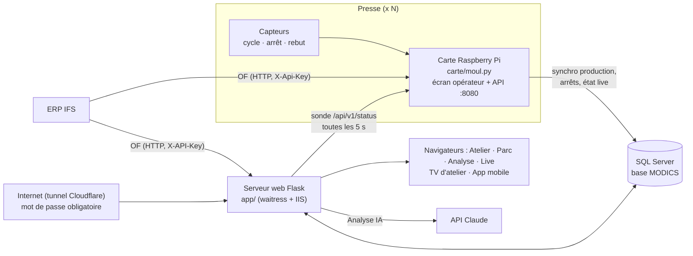

# MODICS — Supervision et collecte de données des presses à injection

MODICS suit en temps réel les presses à injection plastique de l'atelier : état (production / arrêt),
ordre de fabrication (OF) en cours, cadence, rebuts, causes d'arrêt et TRS (OEE). Les données remontent
dans une base SQL Server, sont affichées sur des pages web (bureau, TV d'atelier, téléphone) et
analysées avec Claude.

| Partie | Dossier | Pour qui | Mode d'emploi |
|---|---|---|---|
| **Serveur web** (tableaux de bord, API, app mobile) | [`app/`](app/) | Direction, méthodes, maintenance, administrateurs | [`app/MODE_EMPLOI.md`](app/MODE_EMPLOI.md) |
| **Carte** (terminal Raspberry Pi sur chaque presse) | [`carte/`](carte/) | Opérateurs, régleurs, électroniciens | [`carte/MODE_EMPLOI.md`](carte/MODE_EMPLOI.md) |
| Déploiement et correctifs des cartes | [`terminal/`](terminal/) | Administrateurs | voir `carte/MODE_EMPLOI.md`, partie B § 8 |
| Hébergement IIS | [`site/`](site/) | Administrateurs | voir `app/MODE_EMPLOI.md`, § 6 |

---

## 1. Architecture



**Deux flux de données distincts :**

1. **Historique (base SQL)** : chaque carte écrit dans `Machine_Daily_Table_Mould` (production par équipe),
   `Machine_Stop_Table_Mould` (arrêts) et `Machine_Live_State_Mould` (état en direct). Le serveur lit ces tables
   pour l'analyse et le TRS.
2. **Temps réel (HTTP)** : le serveur interroge l'API de chaque carte toutes les 5 secondes
   (`/api/v1/status`, `/api/v1/queue`) et garde 24 h d'historique en mémoire pour la chronologie,
   la cadence réelle, le MTBF/MTTR et les alertes.

**Deux entrées IFS :** IFS peut pousser ses OF vers **la carte** d'une presse (contrat
[`carte/MODICS_API.md`](carte/MODICS_API.md)) ou vers **le serveur** (`POST /api/ifs/shop-orders`, table
`IFS_Shop_Orders`). Les deux coexistent ; seul le premier alimente directement l'écran de la presse.

## 2. Structure du dépôt

```
app/        Serveur Flask : pages web, API JSON, supervision temps réel, API IFS, analyse IA
carte/      Code du terminal Raspberry Pi : moul.py, interface Kivy, service systemd, scripts SQL
terminal/   Scripts d'administration des cartes (correctifs moul.py, déploiement SSH)
site/       web.config IIS (reverse proxy vers waitress)
start.example.cmd   Modèle de lancement du serveur (à copier en start.cmd, non versionné)
```

## 3. Glossaire

| Terme | Signification |
|---|---|
| **TRS / OEE** | Taux de rendement synthétique = Disponibilité × Performance × Qualité |
| **OF / Shop Order** | Ordre de fabrication issu d'IFS |
| **Équipes** | Shift A 06:00–14:00 · Shift B 14:00–22:00 · Shift C 22:00–06:00 |
| **Journée de production** | 06:00 → 06:00. Le Shift C (nuit) est rattaché au jour J-1 dans les analyses |
| **Régleur** | Technicien de réglage de la presse |
| **Hors planning** | Presse volontairement non planifiée après une fin de production : ni Run ni Arrêt |
| **Arrêt planifié** | Arrêt voulu (changement d'outil, etc.) : exclu du TRS, aucun e-mail envoyé |

## 4. Prérequis

| Composant | Version / remarque |
|---|---|
| Serveur | Windows Server + IIS (ARR), Python 3.14 (waitress), ODBC Driver 17/18 pour SQL Server |
| Base | SQL Server (ou Azure SQL avec Entra ID, voir `app/db.py`) |
| Carte | Raspberry Pi + Automation HAT, Python 3, Kivy 2.3, écran 800×480 |
| Réseau | Le serveur doit atteindre le port **8080** de chaque carte (VLAN de production) |
| Option | Clé `ANTHROPIC_API_KEY` pour le panneau « Analyse IA » |

## 5. Mise en service — vue d'ensemble

1. **Base** : les tables `Machine_*` existent ; exécuter `carte/moul.sql` (état live).
2. **Chaque presse** : installer la carte (`carte/MODE_EMPLOI.md`, partie B § 3), renseigner `config_modics.ini`
   (identifiants SQL, clé API propre à la presse).
3. **Serveur** : copier `start.example.cmd` en `start.cmd`, renseigner les variables, créer
   `app/machines.json` à partir de `app/machines.example.json` (une entrée par presse, avec son IP et sa clé).
4. **Vérifier** : `/fleet` doit montrer chaque presse « en ligne » ; sinon voir les dépannages des deux guides.

## 6. Sécurité

- **Aucun secret dans git.** `start.cmd`, `app/machines.json`, `carte/config_modics.ini`, `carte/press.db`
  et les `.env` sont dans `.gitignore`. Le dépôt est **public** : un secret publié reste dans l'historique,
  il faut alors le **changer**, pas seulement le supprimer.
- Les cartes sont en HTTP simple : à n'exposer que sur le VLAN de production.
- Le trafic venant d'Internet (tunnel Cloudflare) est protégé par identifiant et mot de passe
  (`app/public_gate.py`) avec blocage anti force brute (8 échecs / 10 min / IP).
- Une clé API par presse (`MODICS_PI_KEY_<NN>` ou `machines.json`) limite l'impact d'une fuite.

## 7. Points d'attention connus

| Sujet | Détail | Action proposée |
|---|---|---|
| Correctifs des cartes | `carte/moul.py` ne contient **pas** l'API d'actions ni « hors planning » : ils s'ajoutent avec `terminal/apply_*.py` | Fusionner les correctifs dans `moul.py` pour n'avoir qu'une source de vérité |
| Adresses e-mail | `moul.py` contient les adresses des responsables d'astreinte (dictionnaire `STOP_MAIL`) dans un dépôt public | Les déplacer dans `config_modics.ini` |
| Historique live | Les 24 h d'historique temps réel sont en mémoire : perdus au redémarrage du serveur (la chronologie est toutefois sauvegardée en base chaque minute) | Acceptable ; surveiller les redémarrages |
| Tests | Aucun test automatisé dans le dépôt | Ajouter des tests sur `data_source`, `pi_live._metrics` et `validate_of_payload` |
| Double entrée IFS | Deux voies d'envoi des OF (carte et serveur) | Décider laquelle est la voie cible |
| App mobile | `app/templates/mobile.html` référence `/manifest.json`, absent du dépôt : l'installation en application n'est pas garantie | Ajouter `manifest.json`, les icônes et la route Flask |

## 8. Pour aller plus loin

- Détail technique de l'API serveur : [`app/README.md`](app/README.md)
- Contrat d'interface ERP → carte : [`carte/MODICS_API.md`](carte/MODICS_API.md)
